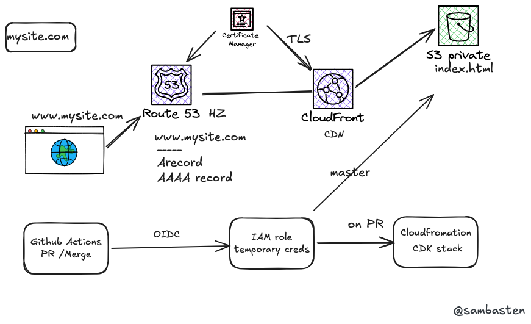

# cdk-my-portfolio-site: my portfolio on S3 + CloudFront, built with AWS CDK and shipped by GitHub Actions

**Live:** [akinwumisamuel.com](https://akinwumisamuel.com)



## The problem
I needed a portfolio site that I own end to end: my own domain, HTTPS, fast everywhere, and close to free to run. Clicking all of that together in the AWS console works once but can't be repeated or reviewed. 

## What I built
A static portfolio site (`mysite/`) served from a private S3 bucket through CloudFront, with every piece of infrastructure defined in one AWS CDK stack written in TypeScript (`infra/lib/cdk-my-portfolio-site-stack.ts`). The CDK app, its `package.json` and tests all live under `infra/`; the site itself has no build step or dependencies.

- **S3** stores the site files. The bucket isn't public; only CloudFront can read it.
- **CloudFront** serves the site over HTTPS (HTTP redirects to HTTPS), adds AWS's managed security-headers policy, caches for 2 minutes by default, and returns a custom `error.html` for 403/404s.
- **ACM** issues the TLS certificate for the apex domain and `*.akinwumisamuel.com`, validated through DNS automatically.
- **Route 53** points both `akinwumisamuel.com` and `www` (IPv4 and IPv6) at the distribution.
- **IAM + GitHub OIDC**: the stack also creates the role that GitHub Actions assumes, scoped to this repo, the CDK deploy roles and this one bucket.
- **GitHub Actions** (`.github/workflows/master.yaml`) runs two pipelines:
  - **On a pull request:** security scan (SAST, IaC and secret scanning with SARIF upload), `cdk synth`, `cdk deploy`, and then a bot comment on the PR saying it's safe to merge.
  - **On a push to `master`:** `aws s3 sync` of `mysite/` to the bucket, deleting any removed files.

## Repository layout

```
mysite/                   the static site: index.html, error.html, css/site.css, js/site.js, images/
infra/                    the AWS CDK app
  bin/                    CDK entry point
  lib/                    the stack (S3, CloudFront, ACM, Route 53, IAM/OIDC role)
  test/                   Jest tests
  cdk.json, tsconfig.json, jest.config.js, package.json
  .env.example            template for local CDK env vars (.env itself is git-ignored)
  myportfoliosite.png     architecture diagram (source: myportfoliosite.excalidraw)
.github/workflows/        the two pipelines described above
```

The site is plain HTML, CSS and JavaScript with no framework, build step or npm dependencies. Everything Node-related lives under `infra/`, so `npm install`, `npm test` and `cdk` are run from there.

## Decisions I made
- **GitHub OIDC over IAM access keys.** The first version of the pipeline used an access key stored in GitHub secrets. I switched to OIDC: each run gets short-lived credentials for a role that only trusts this repository, so there's no key to leak or rotate. Once it worked, I deleted the old keys.
- **Private bucket + CloudFront Origin Access Control over S3 static website hosting.** S3 website endpoints need a public bucket and don't support HTTPS on a custom domain. With OAC the bucket stays private, CloudFront handles TLS and caching, and I get security headers and custom error pages for free.
- **Infrastructure deploys on PRs, content deploys on merge.** Infrastructure changes are rare and risky, so they get scanned, synthesized and deployed while the PR is open, where I can see them fail. Content changes are frequent and low-risk, so merging to `master` just syncs the files. Editing the site never touches CloudFormation.
- **CDK (TypeScript) over clicking it together in the console.** The whole setup lives in about 150 lines of code I can review in a PR, rebuild from scratch or tear down.

## What broke and how I fixed it
**The OIDC role wouldn't let GitHub Actions in.** I wrote the trust policy with the usual subject condition, `repo:sambasten/cdk-my-portfolio-site:*`, but the workflow kept failing to assume the role. To keep shipping, I temporarily rolled the workflow back to access keys while I worked out why.

Going through the GitHub docs showed why. GitHub changed the default OIDC subject claim: since July 2026, new repositories get a stricter `sub` that includes the immutable owner and repository IDs, not just the names. The change stops a recycled repo name from inheriting an old trust policy. My token's subject was really `repo:sambasten@<owner-id>/cdk-my-portfolio-site@<repo-id>:*`. Once I updated the `StringLike` condition to that format, role assumption worked. I switched the workflow back to OIDC and deleted the access keys.

The takeaway: when OIDC trust fails, go to GitHub's docs and changelog for the current claim format before touching the trust policy.

Smaller fixes along the way:
- CloudFront error pages need a leading slash (`/error.html`, not `error.html`).
- A private bucket behind OAC returns **403**, not 404, for missing files, so I map 403 to a 404 response with the custom error page.

## Result
- Live at **https://akinwumisamuel.com** and **https://www.akinwumisamuel.com**, HTTPS only, over IPv4 and IPv6.
- No long-lived AWS credentials anywhere in GitHub.
- Updating the site takes one merge. There are no manual uploads and no console clicks.
- Every infrastructure change is security-scanned and deployed from a PR before it reaches `master`.

## How it ships
This is my personal site, so nobody needs to deploy it except me, and I never deploy it by hand. Everything goes through Git:

| I change... | I do... | What happens |
|---|---|---|
| Site content (`mysite/`) | Merge to `master` | GitHub Actions syncs `mysite/` to S3. CloudFront serves the new version within about 2 minutes. |
| Infrastructure (`infra/`) | Open a PR from `dev` | GitHub Actions runs the security scan, then `cdk synth` and `cdk deploy`, and comments on the PR when it's safe to merge. |

To preview the site locally before pushing, run:

```bash
cd mysite
python3 -m http.server 8000   # then open http://localhost:8000
```

To check infrastructure changes locally (needs AWS credentials for my account):

```bash
cd infra
npm install
npx cdk diff      # what would change in the deployed stack
npm test          # Jest tests
```

**Want to reuse this setup?** Swap the domain, the GitHub repo in the OIDC trust condition and the account ID in `infra/lib/cdk-my-portfolio-site-stack.ts` and `.github/workflows/master.yaml`. Then, from `infra/`, run `npx cdk bootstrap` and `npx cdk deploy` once in `us-east-1` (CloudFront only accepts ACM certificates from that region).

**Walkthrough:** [
    Loom link: https://www.loom.com/share/16908a40e9ef4278a26f18adb4e3e7f0 ,
https://www.loom.com/share/7493bcf195ea4164bf38b5eb664350fd
]
